<h1 align="center">Hi, I'm HEET VINODBHAI GADHIYA 👋</h1>

<b>Machine learning & Edge AI engineer</b>: models that run where the data is, on microcontrollers with kilobytes of memory.

      

## 🧠 About Me

I'm **Heet Vinodbhai Gadhiya**, an **Embedded Systems & Edge AI Engineer**.

I bring **machine learning to the edge**: I design models that learn from real sensor data and deploy them on **microcontrollers and embedded hardware**, where memory is measured in kilobytes and decisions have to be made in real time, without depending on the cloud.

My work sits where **embedded engineering meets artificial intelligence**: from the hardware and firmware, through data and model development, to an optimized model running reliably on the device.

**What I do:**

- ⚡ Develop **real-time embedded software** in C/C++ with **RTOS**, peripheral drivers and efficient on-device signal processing
- 🤖 Build and evaluate **machine-learning and deep-learning models**, from classical algorithms to CNNs, recurrent networks and multi-task architectures
- 📦 **Optimize and deploy ML models on microcontrollers** through model conversion, quantization, on-target validation and profiling of memory, latency and compute
- 🔍 Design **anomaly detection and classification systems** that turn raw sensor signals into reliable decisions
- 🔧 Design **digital hardware** in **VHDL** for **FPGAs**
- 🌐 Connect embedded devices to users through **live dashboards and communication interfaces**
- 📊 Turn data and results into clear **analysis, visualizations and documentation**

**How I work:** I measure before I decide. A good solution is not only accurate. It also runs within the limits of its hardware, behaves reliably on unseen data and is understandable to others.

> **Motto:** Measure it, deploy it, make it useful.

## 🚀 Featured project

<a href="https://github.com/heet4226/EDGE-AI-FOR-ANOMALY-DETECTION/tree/main/projects/edge-ai-motor-monitoring"><picture><source media="(prefers-color-scheme: dark)" srcset="assets/pipeline-dark.svg">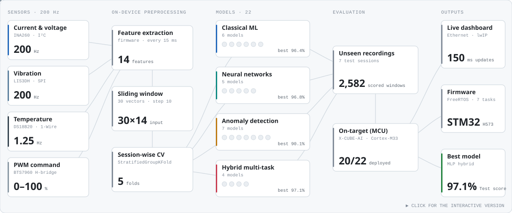</picture></a>

<a href="https://github.com/heet4226/EDGE-AI-FOR-ANOMALY-DETECTION/tree/main/projects/edge-ai-motor-monitoring"><picture><source media="(prefers-color-scheme: dark)" srcset="assets/project-card-dark.svg">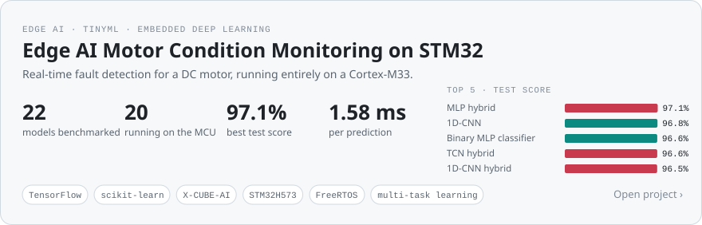</picture></a>

<a href="https://heet4226.github.io/EDGE-AI-FOR-ANOMALY-DETECTION/edge-ai-motor-monitoring/">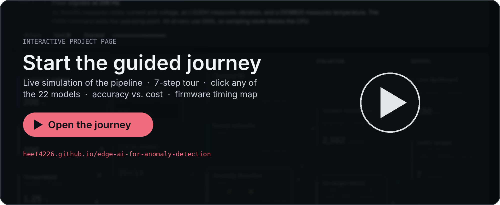</a>

<a href="https://github.com/heet4226/EDGE-AI-FOR-ANOMALY-DETECTION/tree/main/projects/edge-ai-motor-monitoring/firmware/Threads/Ethernet/lwip/webpage">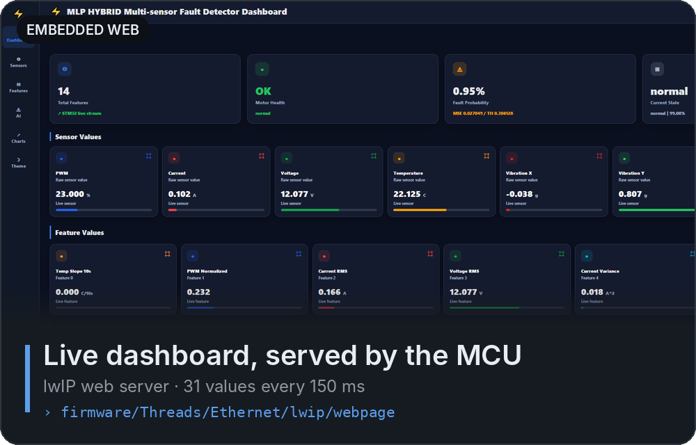</a>
<a href="https://github.com/heet4226/EDGE-AI-FOR-ANOMALY-DETECTION/tree/main/projects/edge-ai-motor-monitoring/firmware/X-CUBE-AI/App">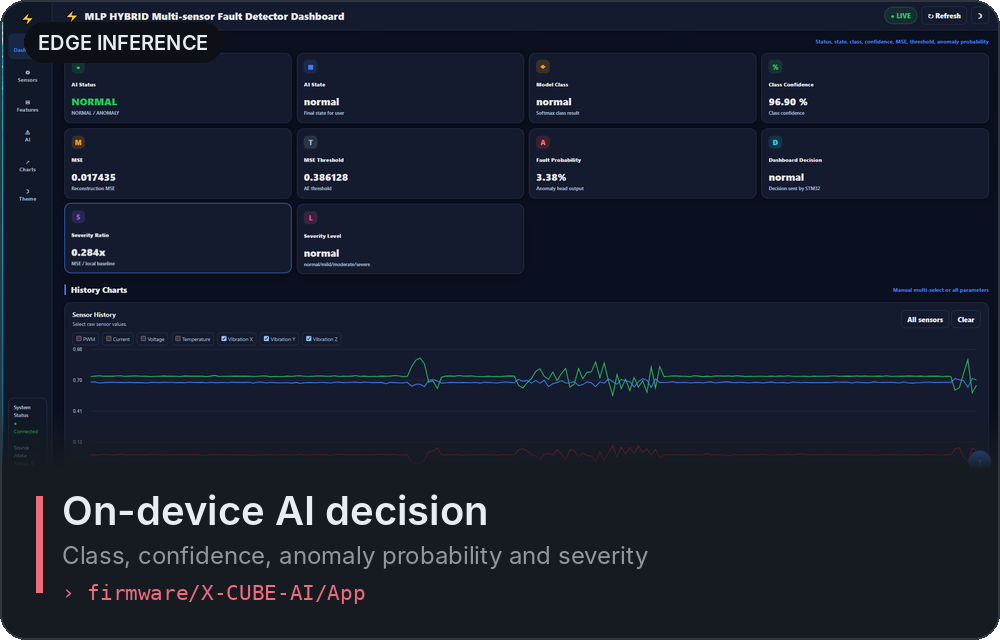</a> 
<a href="https://github.com/heet4226/EDGE-AI-FOR-ANOMALY-DETECTION/blob/main/projects/edge-ai-motor-monitoring/README.md#all-models">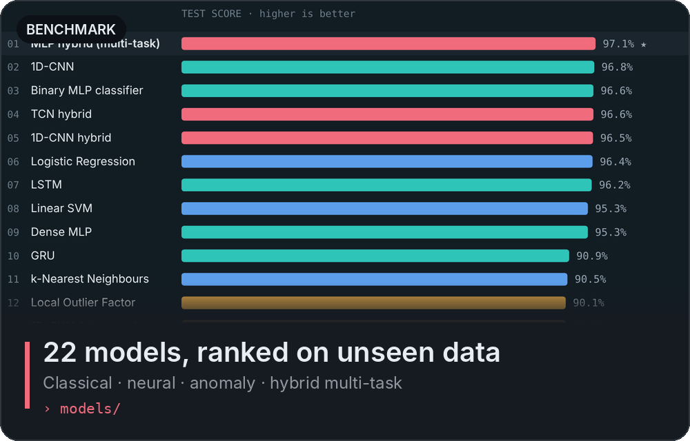</a>
<a href="https://github.com/heet4226/EDGE-AI-FOR-ANOMALY-DETECTION/tree/main/projects/edge-ai-motor-monitoring/models/19_mlp_hybrid">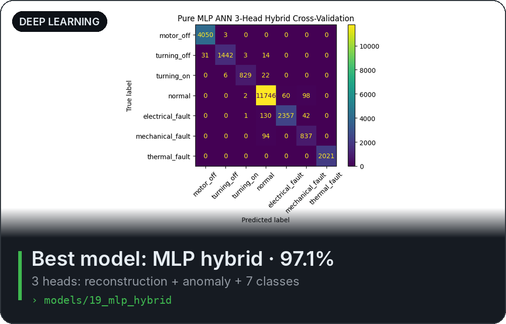</a> 
<a href="https://github.com/heet4226/EDGE-AI-FOR-ANOMALY-DETECTION/blob/main/projects/edge-ai-motor-monitoring/results/model_comparison.csv">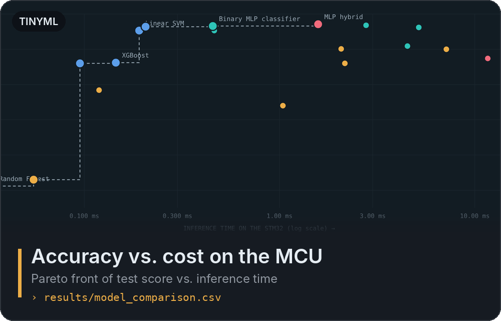</a>
<a href="https://github.com/heet4226/EDGE-AI-FOR-ANOMALY-DETECTION/tree/main/projects/edge-ai-motor-monitoring/firmware">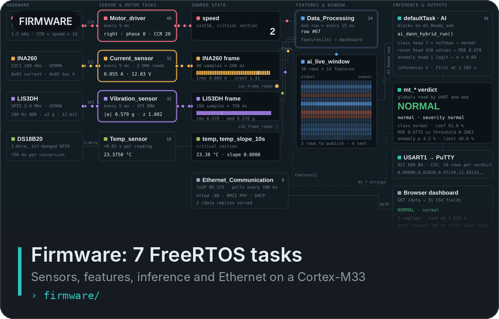</a> 
<a href="https://github.com/heet4226/EDGE-AI-FOR-ANOMALY-DETECTION/tree/main/projects/edge-ai-motor-monitoring/data">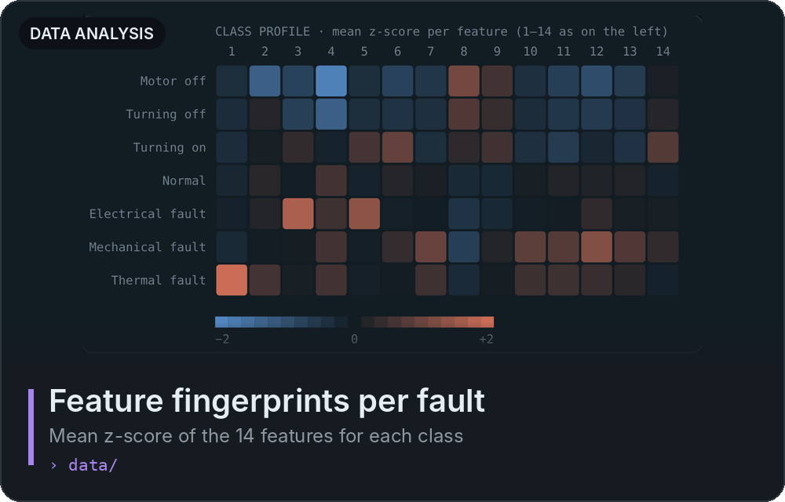</a>
<a href="https://github.com/heet4226/EDGE-AI-FOR-ANOMALY-DETECTION/blob/main/projects/edge-ai-motor-monitoring/models/19_mlp_hybrid/mlp_hybrid.ipynb">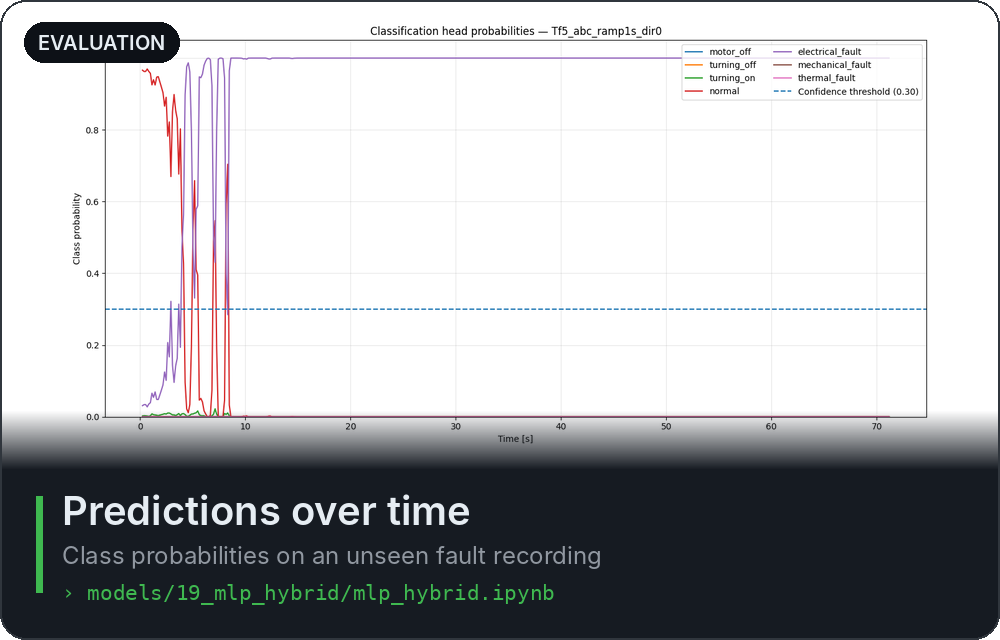</a> 

<a href="https://heet4226.github.io/EDGE-AI-FOR-ANOMALY-DETECTION/edge-ai-motor-monitoring/"><b>▶ Interactive project overview</b></a> · <a href="https://heet4226.github.io/EDGE-AI-FOR-ANOMALY-DETECTION/edge-ai-motor-monitoring/firmware.html"><b>⚙️ Firmware overview</b></a> · <a href="https://github.com/heet4226/EDGE-AI-FOR-ANOMALY-DETECTION"><b>📂 Full portfolio</b></a>

## 📫 Contact

[LinkedIn](https://www.linkedin.com/in/heet-gadhiya-1758aa212)